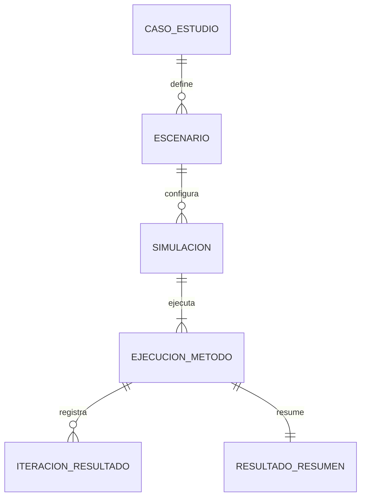

# Diagrama entidad–relación

El navegador crea la base `simtele-risk` con IndexedDB. Las relaciones se escriben juntas en una transacción. Los índices de IndexedDB ayudan a consultar por clave foránea y la aplicación conserva su integridad al guardar.

## Esquema versionado

El [modelo relacional](README.md) identifica las claves de la base. El bloque [`onupgradeneeded` en history.js](history.js) crea los seis almacenes e índices de la versión 1. El campo opcional `criterio` permite cargar ejecuciones antiguas con el mismo esquema.

## Prueba de recuperación

1. Abrir **Deterioro** en **NORMAL** y anotar el cruce de **11,3746 meses**.
2. Guardar una corrida y recargar la página desde el mismo perfil y origen.
3. Abrir **Historial**, localizar la corrida y pulsar **Abrir**. Verificar las entradas, la curva y el detalle numérico.
4. Volver al historial y usar **Relanzar**. La web compara las salidas, filas de iteración y curvas contra la corrida guardada. Para cada magnitud numérica aplica una tolerancia de `1e-10 × max(1, |valor guardado|)`.
5. Leer el mensaje de verificación. Una ejecución guardada con otra versión puede coincidir solo parcialmente si cambió el modelo.

La [prueba automática](../tests/history.test.js) comprueba las seis entidades, la recuperación completa y la reproducibilidad.
